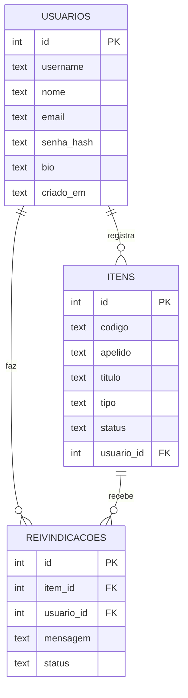

# Achados & Perdidos Senac (Flask)

Portal para registrar e reencontrar objetos perdidos ou encontrados nas unidades Senac.
Versão Flask + SQLite do projeto criado no Lovable (React + Supabase).

## Como rodar

```bash
python -m venv .venv && source .venv/bin/activate   # Windows: .venv\Scripts\activate
pip install -r requirements.txt
python app.py                                        # http://127.0.0.1:5000
```

O banco `banco.db` já vem com dados de exemplo. Se ele não existir, é criado sozinho na primeira execução.
Usuários de exemplo (senha **senac123**): `ana`, `bruno`, `recepcao`.

## Estrutura

```
app.py              rotas, regras de negócio, API JSON
db.py               conexão SQLite, criação das tabelas, dados de exemplo
schema.sql          DDL das 3 tabelas
banco.db            banco com dados de exemplo
templates/          base.html (herança), _macros.html e uma página por tela
static/css|js       estilos (identidade Senac) e recursos de acessibilidade
static/uploads/     fotos enviadas pelos usuários
requirements.txt    flask==3.0.3, gunicorn==22.0.0
Procfile            web: gunicorn app:app
```

## Banco de dados



### Dicionário de dados

**usuarios**

| Campo | Tipo | Descrição |
|---|---|---|
| id | INTEGER PK | Identificador |
| username | TEXT UNIQUE | Nome de usuário público |
| nome | TEXT | Nome completo |
| email | TEXT UNIQUE | E-mail de acesso |
| senha_hash | TEXT | Senha com hash (werkzeug) |
| bio | TEXT | Apresentação curta |
| criado_em | TEXT | Data de cadastro |

**itens**

| Campo | Tipo | Descrição |
|---|---|---|
| id | INTEGER PK | Identificador |
| codigo | TEXT UNIQUE | Código único gerado (SNC-XXXXXXXXXX) |
| apelido | TEXT UNIQUE, nulo | Endereço curto opcional |
| titulo / descricao | TEXT | O que é o objeto |
| categoria | TEXT | Material escolar, Eletrônicos, Documentos… |
| tipo | TEXT | `perdido` ou `achado` (CHECK) |
| status | TEXT | `aberto`, `devolvido` ou `arquivado` (CHECK) |
| local / unidade / curso | TEXT | Onde, em qual unidade e turma |
| contato | TEXT | Contato para devolução |
| data_ocorrido | TEXT | Data do ocorrido (AAAA-MM-DD) |
| imagem | TEXT, nulo | Nome do arquivo em static/uploads |
| usuario_id | INTEGER FK → usuarios.id | Quem registrou (ON DELETE CASCADE) |
| criado_em / atualizado_em | TEXT | Controle de datas |

**reivindicacoes**

| Campo | Tipo | Descrição |
|---|---|---|
| id | INTEGER PK | Identificador |
| item_id | INTEGER FK → itens.id | Item reivindicado (ON DELETE CASCADE) |
| usuario_id | INTEGER FK → usuarios.id | Quem reivindica (ON DELETE CASCADE) |
| mensagem | TEXT | Detalhes que provam a posse |
| status | TEXT | `pendente`, `confirmada`, `recusada`, `retirada` (CHECK) |
| criado_em | TEXT | Data do pedido |

## Rotas

| Rota | Métodos | O que faz |
|---|---|---|
| `/` | GET | Início com contadores e itens recentes |
| `/explorar` | GET | Mural com busca e filtros |
| `/item/<codigo>` | GET | Ficha do item (por código ou apelido) |
| `/registrar` | GET, POST | **Create** — novo registro com foto |
| `/item/<id>/editar` | GET, POST | **Update** — editar registro |
| `/item/<id>/status` | POST | Marcar devolvido, arquivar ou reabrir |
| `/item/<id>/excluir` | POST | **Delete** — remover registro |
| `/item/<id>/reivindicar` | POST | Pedir a devolução de um item |
| `/reivindicacao/<id>/responder` | POST | Dono confirma ou recusa |
| `/reivindicacao/<id>/retirar` | POST | Quem pediu retira o pedido |
| `/meus-registros` | GET | Painel do usuário |
| `/perfil/<username>` | GET | Registros públicos de um usuário |
| `/entrar`, `/cadastrar`, `/sair` | GET/POST | Autenticação por sessão |
| `/acessibilidade` | GET | Descrição dos recursos de acessibilidade |
| **`/api/itens`** | GET | **JSON** — lista itens (`?q=&tipo=&categoria=&unidade=&status=`) |
| **`/api/estatisticas`** | GET | **JSON** — totais por unidade e tipo (JOIN + GROUP BY) |

Consultas com **JOIN**: `itens ⨝ usuarios` (mural, ficha, perfil), `reivindicacoes ⨝ itens ⨝ usuarios` (painel)
e `itens ⟕ reivindicacoes` (estatísticas).

## Acessibilidade

Barra no topo de todas as páginas com **alto contraste** e **ajuste do tamanho da fonte** (A−, A, A+),
preferências salvas no navegador. Também: link "Pular para o conteúdo", foco visível, rótulos em todos os campos,
`alt` nas fotos, avisos com `aria-live` e respeito a `prefers-reduced-motion`.

## Publicar no Render

1. Envie o projeto para um repositório no GitHub.
2. No Render: **New → Web Service**, conecte o repositório.
3. Build command: `pip install -r requirements.txt` · Start command: `gunicorn app:app`.
4. Em *Environment*, crie `SECRET_KEY` com um valor longo e aleatório.

**Atenção:** no plano gratuito do Render o disco é efêmero. A cada novo deploy ou reinício, o `banco.db` volta
ao que está no repositório e as fotos enviadas em `static/uploads/` são perdidas. Para a apresentação isso basta
(os dados de exemplo estarão lá). Para guardar dados de verdade, use um *Persistent Disk* e aponte
`DATABASE_PATH` para ele.

## Segurança

Senhas com hash, proteção CSRF em todos os POST, SQL parametrizado, escape automático do Jinja2,
verificação de dono em editar/excluir/responder, validação de extensão e tamanho (8 MB) das fotos
e redirecionamento `?next=` restrito a caminhos internos.
